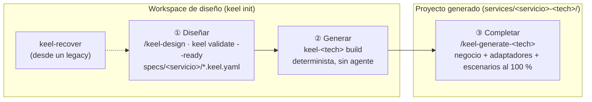
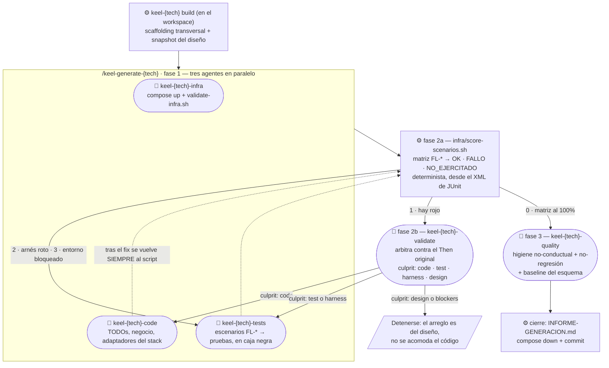

# Keel

**Diseña un servidor una vez. Genéralo en Spring Boot, NestJS o .NET.**

Keel es una metodología para construir servicios de backend con agentes: el diseño se escribe una
sola vez, sin tecnología dentro, en un DSL tipado que se valida con exit code; y un generador por
tecnología lo convierte en un servidor que compila, arranca y pasa el **100 %** de los escenarios del
diseño contra infraestructura real. Si el servicio ya existe, `keel-recover` saca su diseño del código
legacy y demuestra que el servidor regenerado hace lo mismo que el viejo.

La prueba de que la promesa se cumple está en este repo. El mismo diseño (`notification-mailer`, en
su variante relacional y en la documental) se generó con los tres generadores —seis proyectos— y los
seis cerraron **23 de 23 escenarios** con el agente tocando **17 archivos de ~300** que escribió el
generador ([corridas de control](docs/corridas/), 2026-10-18).

**Índice**: [Cómo funciona](#cómo-funciona-en-un-minuto) ·
[Instalación](#requisitos-e-instalación) · [Guía: tu primer servicio](#guía-de-uso-tu-primer-servicio) ·
[Partir de un servicio existente](#partir-de-un-servicio-existente-keel-recover) ·
[Cómo se genera](#cómo-se-genera-cinco-agentes-iterando) · [Qué ganas](#qué-ganas-desarrollando-con-keel) ·
[Referencia](#referencia) · [Estado](#estado-y-roadmap) · [Documentación](#documentación)

## Cómo funciona en un minuto

Hay dos lugares y tres fases:



1. **Diseñar.** En el workspace, conversando con el agente (`/keel-design`), se escribe el diseño del
   servicio: un archivo YAML por capa (dominio, casos de uso, API, seguridad, mensajería,
   persistencia…), sin una sola palabra de tecnología. `keel validate --ready` dice con exit code si
   está listo para generar.
2. **Generar.** `keel-spring build`, `keel-nest build` o `keel-dotnet build` pregunta el stack (base de
   datos, broker, proveedor de identidad…) y escribe de forma determinista todo lo que se deduce del
   diseño: el proyecto compila y arranca antes de que lo toque ningún agente.
3. **Completar.** Dentro del proyecto, `/keel-generate-<tech>` orquesta a cinco subagentes que
   escriben la lógica de negocio y los adaptadores del stack, y no paran hasta que todos los
   escenarios del diseño pasan contra la infraestructura real en contenedores.

El workspace es **solo diseño**. Todo lo que hace falta para generar viaja dentro del proyecto
generado, que se termina y se mantiene sin el workspace.

## Requisitos e instalación

```bash
npm i -g @keel-system/keel-core      # comando `keel`: diseñar y validar (siempre)
npm i -g @keel-system/keel-spring    # comando `keel-spring`, si generas en Spring Boot
npm i -g @keel-system/keel-nest      # comando `keel-nest`, si generas en NestJS
npm i -g @keel-system/keel-dotnet    # comando `keel-dotnet`, si generas en .NET
npm i -g @keel-system/keel-recover   # comando `keel-recover`, si partes de un servicio existente
```

El core y cada generador son paquetes independientes: instala el core y los generadores que vayas a
usar. Necesitas además un agente de código: **Claude Code** u **opencode** (Keel siembra los archivos
de los dos).

| Para… | Hace falta |
|---|---|
| Diseñar (`keel init`, `/keel-design`, `keel validate`, `keel system`, `keel registry`) y **generar** (`keel-<tech> build`) | **Node.js >= 18** y nada más. Todo es offline y determinista; el registry es lo único que toca la red. |
| **Completar y validar** el proyecto generado (`/keel-generate-<tech>`) | El toolchain de la tecnología —**JDK 21** para keel-spring, **Node.js >= 22.12** para keel-nest, **SDK de .NET 10** para keel-dotnet— y un **runtime de contenedores: Docker o Podman**. |
| **Recuperar** un legacy (`keel-recover`) | Node.js >= 18, Docker o Podman en marcha y el repo git del legacy. En Windows, Git Bash con `export MSYS_NO_PATHCONV=1`. |

El runtime de contenedores **es el precio de que «terminado» signifique algo**: la validación no usa
dobles de la fontanería, levanta la infraestructura de verdad (`infra/docker-compose.yaml`) y ejecuta
contra ella los escenarios `FL-*`. Sin contenedores el pipeline genera y compila, pero no puntúa un
solo escenario, y lo reporta como `PENDIENTE` en vez de fingir un verde. El runtime se detecta solo
—`docker` primero, `podman` si no— y se fuerza con `CONTAINER_RUNTIME=podman`.

## Guía de uso: tu primer servicio

Los comandos `keel …` se ejecutan en una terminal; las skills `/keel-…` se invocan dentro del agente
(Claude Code u opencode) abierto en el workspace.

### 1. Siembra el workspace

```bash
mkdir mi-proyecto && cd mi-proyecto
keel init
```

Siembra las ocho skills del flujo de diseño, los JSON Schema del DSL, las plantillas, la documentación
y un `AGENTS.md`/`CLAUDE.md` que explica el flujo al agente ([qué queda dentro](#el-workspace-sembrado)).
Conviene versionarlo con git: el diseño es la fuente de verdad del servicio.

Cuando actualices `@keel-system/keel-core`, `keel init --check` te dice si el payload sembrado quedó
atrás respecto a la CLI instalada.

### 2. ¿Ya existe un diseño que te sirva?

Antes de diseñar de cero, busca en el [registry](https://github.com/keel-system/keel-registry):

```bash
keel registry search catalogo
keel registry show catalog                       # qué trae
keel registry get catalog                        # ADOPTAR: lo copia tal cual, listo para generar
keel new mi-catalogo --from registry:catalog     # DERIVAR: copia que vas a cambiar, con linaje en service.basedOn
```

Adoptar no cuesta nada; derivar cuesta una revisión de lo que cambies
([design-registry.md](packages/keel-core/assets/core/docs/design-registry.md)).

### 3. ¿Es un servicio o un sistema?

Si el encargo trae varios servicios dentro, empieza un nivel por encima:

```
/keel-decompose docs/system/tdr.md
```

Decide las fronteras contigo y escribe `system.yaml` (qué servicios hay, quién consume a quién) y un
brief por servicio. `keel system show` calcula **en qué orden se construyen** (olas, por las
dependencias bloqueantes) y `keel system check` es la comprobación cross-servicio, útil como puerta de
CI. Cada servicio se diseña después por separado, y varias personas pueden hacerlo en paralelo
([system-decomposition.md](packages/keel-core/assets/core/docs/system-decomposition.md)).

### 4. Diseña conversando

```bash
keel new mi-servicio                             # crea specs/mi-servicio/ desde plantillas
```

```
/keel-design specs/mi-servicio
```

`/keel-design` recorre el diseño **capa a capa** (dominio, casos de uso y, si hacen falta, API,
seguridad, mensajería, clientes HTTP, persistencia, storage, correo, pagos). No tienes que aprender el
DSL: el agente pregunta, recomienda con su porqué y escribe el YAML. Tú decides.

Lo que el diseño no puede dejar sin decidir —outbox o publicación en línea, qué operación se puede
repetir sin cobrar dos veces, qué pasa si el proveedor no responde— son **obligaciones con id
estable**. Cada una se cierra declarándola en el DSL o aceptándola por escrito, con su motivo, en
`specs/mi-servicio/decisions.yaml`. Al cerrar, el agente deriva los escenarios de validación
(`validation-scenarios.md`, Given/When/Then con id `FL-*`) y el `DESIGN.md`.

Para revisar el diseño **no leas el YAML**: lee `DESIGN.md` y el panel que genera

```
/keel-docs specs/mi-servicio
```

junto con `openapi.yaml`, `asyncapi.yaml` y una colección Postman. El panel `overview.html` es la
superficie de revisión del diseño.

Otras skills del flujo: `/keel-validate` (revisión semántica: invariantes, mínimo privilegio…),
`/keel-consume` (depender de otro servidor a partir de su `INTEGRATION.md`), `/keel-integrate`
(escribir el `INTEGRATION.md` de tu servicio para quien lo consuma), `/keel-handoff` (regenerar
`DESIGN.md` para otro equipo) y `/keel-evolve` (cambiar un diseño cerrado, en el paso 8).

### 5. Valida

```bash
keel validate specs/mi-servicio                  # schema por capa + referencias cruzadas + obligaciones
keel validate specs/mi-servicio --ready          # ¿listo para generar? la checklist completa del cierre
keel describe mi-servicio                        # resumen del diseño y frescura de sus derivados
```

`--ready` compone el veredicto: validación estricta, obligaciones, análisis de huecos, revisión,
escenarios, careo de flujos y `DESIGN.md`. Cada rojo lleva un id estable (`CHK-*`, `OBL-*`, `REV-*`)
que se busca en [design-obligations.md](packages/keel-core/assets/core/docs/design-obligations.md) y
en la documentación del DSL. Lo normal es pedirle al agente que lo cierre: cada aviso es una decisión
sin tomar.

### 6. Genera

```bash
keel-spring check specs/mi-servicio              # opcional: no escribe nada, dice si es generable y qué quedará al agente
keel-spring build specs/mi-servicio              # pregunta el stack y genera services/mi-servicio-spring/
```

(Igual con `keel-nest` o `keel-dotnet`.) `build` pregunta el stack —motor de base de datos, broker,
proveedor de identidad, caché, storage, pasarela de pago… según lo que pida el diseño— o toma los
defaults con `-y`; `--telemetry otel` añade OpenTelemetry. Lo elegido queda en el proyecto
(`keel-stack.json`), nunca en el diseño.

`build` **se niega a generar un diseño que no esté listo** (`--ready` en rojo). Saltárselo exige
`--accept-unready`, y queda estampado en `keel-generated.json`. Lo que un generador aún no sostiene
tampoco lo genera a medias: lo rechaza diciendo por qué.

### 7. Completa el proyecto

```bash
cd services/mi-servicio-spring
```

```
/keel-generate-spring
```

Se invoca **sin argumentos** y en una sesión del agente abierta dentro del proyecto. Orquesta cinco
subagentes ([cómo](#cómo-se-genera-cinco-agentes-iterando)): escriben la lógica de negocio y los
adaptadores del stack, levantan `infra/`, convierten los escenarios `FL-*` en pruebas de integración e
iteran hasta que todas pasan. Está terminado cuando el proyecto compila en verde y el **100 %** de los
escenarios pasa contra la infraestructura real, puntuado por un script (`infra/score-scenarios.sh`) y
no por el juicio de un agente. Cierra con `INFORME-GENERACION.md` y un commit.

Si un escenario falla porque el diseño está mal, el pipeline **se detiene**: el arreglo se hace en el
diseño, no se acomoda el código. Si queda algún hueco del diseño, se anota en `design-gaps.yaml`.

Para probarlo a mano, `deploy/` levanta el servicio en contenedor con su infraestructura.

### 8. Evoluciona

Un cambio funcional se hace **en el diseño** y se regenera; nunca en el código generado.

```
/keel-evolve specs/mi-servicio                   # cambia el diseño y pone al día sus derivados
```

```bash
keel-spring build specs/mi-servicio --refresh --prune   # calcula el delta y escribe build/keel-refresh/EVOLUTION.md
cd services/mi-servicio-spring && /keel-generate-spring # el pipeline trabaja solo sobre lo que cambió
```

`keel-generated.json` distingue lo que escribió `build` de lo que escribió el agente, así que
`--refresh` actualiza el scaffolding (también cuando el arreglo viene de una versión nueva del
generador) **sin pisar la lógica de negocio**. `keel-spring build --check` falla en CI si un proyecto
quedó atrás. Cambiar de stack —de PostgreSQL a MongoDB, de RabbitMQ a Kafka, de Java a C#— es volver
a ejecutar `build`, no rediseñar.

## Partir de un servicio existente: keel-recover

`keel-recover` hace ingeniería inversa de un servicio que ya existe: saca un diseño Keel **fiel**, con
la procedencia de cada decisión, lo regenera con cualquiera de los tres generadores y **mide la
paridad** entre el legacy y el regenerado ejecutando los mismos flujos contra los dos. La única
entrada es el repo del legacy con su historial de git, y **nunca lo modifica**: todo lo que escribe va
al workspace de diseño (`legacy/<servicio>/` y `specs/<servicio>/`).

**¿Encaja tu legacy?** Solo hace lo que se ha medido:

| Pieza | Soportado hoy |
|---|---|
| Lenguaje y build | Java con Maven o Gradle, Node |
| Rutas | Express, Spring 4 (por su log), Spring con actuator; si no, la superficie se escribe a mano |
| Base de datos | MongoDB, PostgreSQL (9.4+) y MySQL (8.0+) |
| Broker | solo RabbitMQ |

**El uso normal son dos llamadas**, desde la raíz del workspace de diseño:

```bash
keel-recover init ../repos/mi-legacy --name mi-servicio   # una vez: prepara legacy/mi-servicio/ y siembra skills y subagentes
```

```
/keel-recover-run legacy/mi-servicio
```

`/keel-recover-run` hace el recorrido entero: monta el legacy en un sandbox, lo observa con rondas de
sondas que graban respuestas y efectos (base, llamadas salientes, broker, correo), escribe el diseño
desde lo grabado marcando cada flujo como *keep*, *fix*, *frontier* o *new*, ejecuta los escenarios
contra el legacy (`FIDELITY.md`), cierra el diseño y genera. Mira en disco dónde se quedó
(`keel-recover status`), así que se puede cortar y **volver a lanzar con la misma llamada**.

```
init → sandbox → observe → explore ⏸ → design ⏸ → characterize → close ⏸ → build → generate ✋ → parity → done
                                   (⏸ te pregunta)                              (✋ lo lanzas tú)
```

Te pregunta en tres momentos, con todo agrupado: al terminar la exploración, al terminar el diseño
(cada *fix* y cada decisión que el legacy no tomaba) y antes de generar (generador y stack). Se para
en la generación, porque `/keel-generate-<tech>` no se anida: la lanzas tú dentro del proyecto y
después vuelves a lanzar `/keel-recover-run`, que levanta el `deploy/` del regenerado, compara todos
los datos de cada flujo con los del legacy y deja `PARITY-<destino>.md`.

Guía completa, paso a paso y con los errores frecuentes: [guides/GUIA-KEEL-RECOVER.md](guides/GUIA-KEEL-RECOVER.md).
Referencia de comandos: [packages/keel-recover/README.md](packages/keel-recover/README.md).

## Cómo se genera: cinco agentes iterando

Dentro del proyecto generado, `/keel-generate-<tech>` **no escribe código**: orquesta cinco subagentes
y decide el avance sobre el bloque estructurado —`status`, `blockers`, `failures`— con el que cada uno
cierra su reporte. Los nodos **redondeados con 🤖** son sesiones de agente (cuestan contexto y tiempo);
los **rectos con ⚙** son deterministas y no cuestan nada.



**Criterio de terminado**: el proyecto compila en verde (`./gradlew build`, `npm run build` o
`dotnet build`) y el **100 %** de los escenarios `FL-*` del diseño pasa contra la infraestructura real,
puntuado por el script y no por un juicio. El pipeline completo de cada generador —gating, handoffs,
ciclos de fix y su cupo— está en su `orchestration.md`:
[spring](packages/keel-spring/assets/generators/spring/orchestration.md) ·
[nest](packages/keel-nest/assets/generators/nest/orchestration.md) ·
[dotnet](packages/keel-dotnet/assets/generators/dotnet/orchestration.md).

## Qué ganas desarrollando con Keel

### 1. Eliges la tecnología al final, y puedes cambiarla

El diseño no lleva lenguaje, framework, ORM, broker ni base de datos. Los tres generadores siguen una
sola regla: **el mismo diseño genera servidores equivalentes**, y equivalentes quiere decir medido:

- el **mismo contrato HTTP**: el `docs/openapi.yaml` que deriva cada generador es el mismo byte a byte;
- el **mismo cable**: cómo viaja cada tipo en JSON, la forma del error, la página y la envoltura;
- los **mismos eventos y destinos**, las **mismas tablas, columnas, índices y FK**, los **mismos
  errores y mensajes**, las **mismas variables de entorno** y las **mismas series de telemetría**.

Lo que no depende del lenguaje vive una sola vez en el núcleo neutral `keel-core/gen`, y un test
(`gen-neutral.test.js`) impide que ahí entre el nombre de un lenguaje.

| | keel-spring | keel-nest | keel-dotnet |
|---|---|---|---|
| Plataforma | Spring Boot 4.1 · Java 21 · Gradle | NestJS 12 · Fastify · Node 22 · TypeScript strict | .NET 10 · un proyecto por capa · xUnit v3 |
| Relacional | PostgreSQL, MySQL, MariaDB, SQL Server, Oracle | PostgreSQL, MySQL | PostgreSQL, MySQL (EF Core) |
| Documental | MongoDB | MongoDB | MongoDB |
| Brokers | RabbitMQ · Kafka · SNS/SQS | RabbitMQ · Kafka · SNS/SQS | RabbitMQ · Kafka · SNS/SQS |
| Identidad | Keycloak · Cognito | Keycloak · Cognito | Keycloak · Cognito |
| Caché · storage · correo | Redis/Valkey · S3/MinIO · SMTP | Redis/Valkey · S3/MinIO · SMTP | Redis/Valkey · S3/MinIO · SMTP |
| Pagos | Stripe · MercadoPago | Stripe · MercadoPago | Stripe · MercadoPago |

Lo que un generador aún no sostiene **lo rechaza en `build` diciendo por qué**
(`src/lib/supported-features.js` de cada uno); los motores que faltan en NestJS y .NET faltan porque
ninguna red los ha ejecutado todavía. En .NET, ningún paquete con licencia comercial: versión exacta y
SPDX de cada uno en `keel-dotnet/src/lib/dotnet-stack.js`, comprobados contra nuget.org con los
transitivos.

### 2. Lo derivable no lo escribe un agente

Si el dominio declara un agregado con sus invariantes y los casos de uso declaran la operación que lo
toca, entonces el controller, el DTO, el comando, el handler, el puerto, el mapeo de columnas, la
jerarquía de errores, la config por perfiles y la infraestructura de prueba **no son decisiones: son
consecuencias**. `keel-<tech> build` las genera de forma determinista —más de 70 módulos de
scaffolding en cada generador— y al agente le queda solo lo que el diseño no determina.

`keel-generated.json` registra cada archivo que escribió `build`; comparándolo con el árbol final se
mide la **huella del agente**:

| Corrida de control (2026-10-18) | Archivos de `build` | Reescritos por el agente | Escenarios |
|---|---|---|---|
| notification-mailer · spring | 320 | 17 | 23/23 |
| notification-mailer · nest | 304 | 17 | 23/23 |
| notification-mailer · dotnet | 329 | 17 | 23/23 |
| notification-mailer-mongo · spring | 305 | 17 | 23/23 |
| notification-mailer-mongo · nest | 294 | 17 | 23/23 |
| notification-mailer-mongo · dotnet | 318 | 18 | 23/23 |

La huella es la misma en los tres lenguajes porque es la huella **del diseño**, no del stack. Los
árbitros tampoco son agentes: con la suite al 100 % el pipeline pasa a la fase de calidad sin invocar
a ninguno.

### 3. Las decisiones se toman a la vista, y antes de generar

Si nadie escribe una decisión, la toma el agente al teclear, y en el código un valor decidido y uno
asumido se ven igual. En Keel son obligaciones con id estable que `keel validate` deja en rojo hasta
que se declaran o se aceptan por escrito, y `build` no genera un diseño que no esté listo. El YAML es
la interlingua entre agentes —uno diseña, otro genera, otro valida— y, a diferencia de un prompt, es
legible, versionable y revisable en un diff.

### 4. Los patrones difíciles vienen puestos, y medidos

Los mecanismos de fiabilidad distribuida comparten un rasgo: **cuando están mal, no falla nada
visible**. Por eso en Keel se derivan del diseño y los genera `build` enteros en los tres generadores.

| Mecanismo | Qué evita |
|---|---|
| **Outbox** + relay con lease, backoff, purga y rendición | publicar un evento que la transacción revirtió, o perderlo sin enterarse |
| **Idempotencia de petición** | que el reintento del cliente ejecute el cobro dos veces |
| **Deduplicación de reentrega** del broker | que la segunda entrega del mismo mensaje vuelva a aplicar el efecto |
| **Idempotencia saliente** | que *nuestro* reintento duplique el cargo en el proveedor |
| **Compensación** | trabajo encargado a un tercero que se queda hecho cuando el flujo se cae |
| **Reconciliación** | la fila que espera para siempre un desenlace que nunca llegó |
| **Reclamo de barrido** y **rescate** con cota temporal | dos réplicas procesando la misma fila, o la fila que una réplica muerta dejó a medias |
| **Guarda de efecto externo irreversible** | el segundo correo real, el segundo envío |
| **Unicidad condicionada al estado** | dos filas activas a la vez por una carrera que el handler no cierra |
| **Eventos de dominio** con envoltura y correlación end-to-end | el evento sin hecho, y la traza que se corta al salir del proceso |
| **Circuit breaker + retry** con fallback tipado | que un proveedor caído se lleve por delante el servicio |
| **Caché** con TTL y degradación a miss | servir datos rancios sin que nadie haya dicho cuánto es demasiado |
| **Seguridad**: realm aprovisionado, matriz M2M, identidad del llamante, alcance por recurso y por propietario | que el llamante elija de qué inquilino lee, o lea lo que no es suyo |
| **Pagos** con pasarela, avisos verificados y conciliación | cobrar dos veces, o dar por cobrado lo que la pasarela rechazó |

Nada de esto se comprueba leyendo código: **se ejecuta**, contra bases de datos, brokers, Keycloak,
WireMock, Mailpit y Redis en contenedores. Y cada red se ha roto a propósito (**medición por
mutación**) para comprobar que se pone roja. La matriz de paridad de cada generador lo resume, celda
por mecanismo y motor:

| Generador | Matriz (`npm run matrix --workspace packages/<gen>`) |
|---|---|
| keel-spring | 54 celdas · 36 verificadas contra un motor real, 33 de ellas falsadas · 12 sin ejecutar · 2 degradadas |
| keel-nest | 38 celdas · 33 verificadas · 3 degradadas · 0 pendientes |
| keel-dotnet | 38 celdas · 33 verificadas, ninguna sin falsar · 3 degradadas · 0 pendientes |

Lo que un motor no sostiene —la unicidad condicionada en MariaDB y en Oracle, por ejemplo— se declara
`degradado`, con la garantía que se pierde, en vez de fingirse.

### 5. Todos los servicios salen iguales, y el diseño se reutiliza

La arquitectura no la elige el agente: hexagonal + CQRS, los mismos paquetes y nombres, la misma
`infra/`, el mismo `deploy/`, el mismo `docs/keel/` (en .NET la frontera hexagonal la impone el
compilador). Leer el servicio número N cuesta lo mismo que leer el primero, y cada proyecto es
autosuficiente: lleva el snapshot sellado del diseño, los contratos y los agentes de su generador. El
diseño se reutiliza **entre stacks y lenguajes** (otro `build`), **entre organizaciones** (el
registry) y **hacia los proyectos ya generados** (`build --refresh`).

## Keel frente a la SDD tradicional

[spec-kit](https://github.com/github/spec-kit) y [OpenSpec](https://github.com/fission-ai/openspec)
especifican **un cambio sobre un repositorio que ya existe**, en prosa, y su salida es un parche.
Keel especifica **un servicio entero**, tipado y sin tecnología dentro, y su salida es el servidor.

| | spec-kit / OpenSpec | Keel |
|---|---|---|
| Objeto de la spec | un cambio o feature sobre un repo vivo | un servicio completo, o un sistema de servicios |
| Formato | Markdown en prosa | YAML tipado, una capa por preocupación |
| Validación | estructura del documento + juicio del agente | JSON Schema + referencias cruzadas + obligaciones abiertas + `--ready`, con exit code |
| Tecnología | entra en el plan | fuera del diseño; se elige al generar |
| Salida | tareas que el agente implementa | proyecto generado: scaffolding determinista + lo que depende de la infra |
| Terminado | la checklist de tareas | suite de integración al 100 % contra infraestructura real |
| Reutilización | dentro del repo | entre stacks, **entre lenguajes** y entre organizaciones |
| Alcance | una feature | un sistema: descomposición, olas de construcción y validación cross-servicio |

**El diseño sigue siendo la fuente de verdad después de generar.** Un cambio funcional se hace en el
diseño y se regenera, nunca en el código generado.

### Cuándo usar Keel, y cuándo no

**Sí:**
- un servicio de backend **nuevo**, que aún no tiene código;
- un encargo con **varios servicios** dentro y fronteras por decidir;
- el mismo dominio en **más de un stack o lenguaje**, o migrando de uno a otro;
- un diseño que alguien tiene que **aprobar antes** de que exista código;
- **reescribir un servicio existente** con la paridad medida, vía `keel-recover`, si encaja en
  [lo que soporta](#partir-de-un-servicio-existente-keel-recover).

**No** (y ahí spec-kit u OpenSpec encajan mejor):
- evolucionar un repositorio existente que no salió de Keel y que no se va a regenerar;
- frontend, scripts, trabajo exploratorio;
- un cambio de una tarde sobre algo que ya funciona.

## Referencia

### Comandos

**`keel`**: diseñar y validar.

| Comando | Qué hace |
|---|---|
| `keel init [--force] [--check]` | Siembra el workspace: skills del flujo de diseño (proyectadas a cada harness), schemas, plantillas, docs y `AGENTS.md`/`CLAUDE.md`. Con `--check` falla si el payload quedó atrás respecto a la CLI instalada. |
| `keel new <servicio> [--from <origen>]` | Crea `specs/<servicio>/` desde plantillas, o lo deriva de un diseño local o `registry:<diseño>` con linaje en `service.basedOn`. |
| `keel validate <ruta> [--ready]` | Schema de cada capa + referencias cruzadas + obligaciones. Con `--ready`, la checklist completa de «diseño listo para generar». |
| `keel describe <servicio>` | Resume un diseño: identidad, capas, contenido y frescura de sus derivados. |
| `keel seals <servicio>` | Imprime los sellos del careo de flujos (`flow-review.yaml`). |
| `keel index [--check]` | Índice de diseños del workspace (`README.md` entre marcadores e `index.json`). Con `--check`, puerta de CI de un registry. |
| `keel system [show \| check]` | El mapa del sistema (`system.yaml`): olas de construcción y la única comprobación cross-servicio. |
| `keel registry [list \| search \| show \| get]` | Explora y adopta diseños del registry. Fuente con `--source` o `KEEL_REGISTRY_URL`; caché en `~/.keel/registry/`. |
| `keel list` | Los generadores conocidos y su paquete npm. |

**`keel-spring` · `keel-nest` · `keel-dotnet`**: generar.

| Comando | Qué hace |
|---|---|
| `keel-<tech> check <ruta>` | Pasada en seco: si el diseño es generable y qué quedará como trabajo del agente. No escribe nada. |
| `keel-<tech> build <ruta>` | Valida, exige el diseño listo, pregunta el stack y genera `services/<servicio>-<tech>/`. Nunca escribe en el workspace de diseño. |
| `  --refresh [--prune]` | Pone al día lo que generó `build` sin pisar lo que escribió el agente (y poda lo que ya no se emite). |
| `  --check` | No escribe: falla si el proyecto quedó atrás respecto al generador instalado. |
| `  --accept-unready` · `-y` · `--telemetry otel\|none` | Generar un diseño no listo (queda estampado) · defaults del stack sin cuestionario · OpenTelemetry vía colector. |

**`keel-recover`**: recuperar un legacy. Lo normal es `init` + `/keel-recover-run`; el resto son los
pasos que el orquestador llama por dentro.

| Comando | Qué hace |
|---|---|
| `keel-recover init <repo> --name <servicio>` | Prepara `legacy/<servicio>/` en el workspace y siembra las skills y los subagentes de la recuperación. |
| `keel-recover status <legacy>` | En qué paso está la recuperación, derivado de lo que hay en disco. |
| `keel-recover fingerprint` · `env-deps` | Paso 0: huella del runtime (`runtime.yaml`) y dependencias del entorno (`environment.yaml`). |
| `keel-recover verify` | Paso 0f: el juez del sandbox; en verde toma el snapshot de la base. |
| `keel-recover introspect` · `probe` | Paso 1: la superficie del legacy y las rondas de sondas con sus efectos grabados. |
| `keel-recover characterize` · `fixtures` | Paso 5: los escenarios contra el legacy (`FIDELITY.md`) y su estado de partida (`fixtures.yaml`). |
| `keel-recover target` · `parity` | Paso 7: describe el regenerado en marcha y compara sus flujos con el legacy (`PARITY-<destino>.md`). |

### Skills

| Dónde | Skill | Para qué |
|---|---|---|
| Workspace (`keel init`) | `/keel-decompose` | Repartir un encargo en servicios: fronteras, `system.yaml` y briefs. |
| | `/keel-design` | Diseñar un servicio capa a capa; al cerrar deriva escenarios y `DESIGN.md`. |
| | `/keel-validate` | Revisión semántica del diseño (lo que solo un lector puede juzgar). |
| | `/keel-docs` | `openapi.yaml`, `asyncapi.yaml`, colección Postman y el panel `overview.html`. |
| | `/keel-consume` · `/keel-integrate` | Depender de otro servidor desde su `INTEGRATION.md` · escribir el `INTEGRATION.md` de este servicio. |
| | `/keel-handoff` · `/keel-evolve` | `DESIGN.md` para otro equipo · cambiar un diseño cerrado y poner al día sus derivados. |
| Workspace (`keel-recover init`) | `/keel-recover-run` | La recuperación entera de un legacy, reanudable. |
| | `/keel-recover-sandbox` · `/keel-recover` | Montar el sandbox del legacy · escribir el diseño desde las grabaciones. |
| Proyecto generado (`build`) | `/keel-generate-<tech>` | Completar el proyecto hasta el 100 % de los escenarios. Sin argumentos. |

### El workspace sembrado

```
mi-proyecto/
├── AGENTS.md / CLAUDE.md     # el flujo, para el agente; un archivo de contexto por harness
├── README.md                 # índice de servicios diseñados (enlaza cada DESIGN.md)
├── .claude/ · .opencode/     # skills (y subagentes) proyectados desde una fuente única para cada harness
├── schema/                   # un JSON Schema por capa + common.schema.json
├── system.yaml               # el mapa del sistema, si hay más de un servicio (de /keel-decompose)
├── specs/<servicio>/         # el diseño de cada servicio, un artefacto por capa: la fuente de verdad
│   ├── service.keel.yaml     #   manifiesto: identidad + capas declaradas
│   ├── domain.keel.yaml      #   entidades, types, invariantes (obligatoria)
│   ├── use-cases.keel.yaml   #   operaciones, idempotencia, caché (obligatoria)
│   ├── *.keel.yaml           #   api, security, messaging, http-clients, dependencies,
│   │                         #   persistence, storage, mail, payments (opcionales)
│   └── decisions.yaml, validation-scenarios.md, DESIGN.md…   # decisiones, escenarios y derivados
├── templates/service/        # una plantilla por capa
├── contracts/<proveedor>/    # INTEGRATION.md de servidores externos de los que dependemos
├── legacy/<servicio>/        # solo con keel-recover: sandbox, sondas, grabaciones y paridad
├── index.json                # índice máquina de los diseños (keel index)
├── docs/                     # methodology, dsl-reference, dsl/<capa>.md, building-a-generator…
└── services/<servicio>-<tech>/  # proyectos generados por `keel-<tech> build` (un repo git cada uno)
```

### Principios

- **El diseño es la fuente de verdad.** Todo lo que un generador necesita saber está en los artefactos.
- **Ninguna decisión estructural sin respuesta.** El agente recomienda con su porqué, el humano decide,
  y lo que queda sin decidir bloquea la validación hasta que se declara o se acepta por escrito.
- **Cero tecnología en el diseño.** Lenguaje, framework, ORM, broker, proveedor de identidad o base de
  datos se deciden al generar.
- **Lo que no se sabe generar se rechaza, no se ignora.** Cada generador dice qué no sostiene y por qué.
- **Regenerable.** Cambiar de stack o de lenguaje es volver a ejecutar la generación.

## Paquetes

Monorepo npm workspaces; los cinco paquetes están publicados en npm con el scope `@keel-system`.

| Paquete | CLI | Versión | Qué hace |
|---|---|---|---|
| [`@keel-system/keel-core`](packages/keel-core/README.md) | `keel` | 0.5.0 | Siembra workspaces, crea, valida y describe diseños, el mapa del sistema y el registry. Define el DSL (schemas, docs, plantillas) y expone `keel-core/gen`, el núcleo neutral que comparten los generadores. |
| [`@keel-system/keel-spring`](packages/keel-spring/README.md) | `keel-spring` | 0.2.0 | Generador Spring Boot 4.1.2 / Java 21: `services/<servicio>-spring/`, con el wrapper de Gradle vendorizado. |
| [`@keel-system/keel-nest`](packages/keel-nest/README.md) | `keel-nest` | 0.1.0 | Generador NestJS 12 sobre Fastify, ESM, TypeScript strict y Vitest: `services/<servicio>-nest/`. |
| [`@keel-system/keel-dotnet`](packages/keel-dotnet/README.md) | `keel-dotnet` | 0.1.0 | Generador .NET 10, un proyecto por capa, sin librerías de licencia comercial: `services/<servicio>-dotnet/`. |
| [`@keel-system/keel-recover`](packages/keel-recover/README.md) | `keel-recover` | 0.0.1 | Ingeniería inversa de un servicio existente hacia un diseño Keel, con la fidelidad y la paridad medidas. |

El detalle de cada uno —qué genera `build`, qué deja al agente y su frontera— está en su README.

## Estado y roadmap

- **DSL Keel 2.23**: once capas (dos obligatorias, nueve opcionales) con validación en tres niveles
  —JSON Schema por capa, referencias cruzadas mecánicas y revisión semántica del agente— y el
  veredicto `--ready`.
- **Tres generadores** —Spring Boot 4.1.2, NestJS 12 y .NET 10— cerrados con la corrida de control del
  par del MVP: 6 × 23/23, huella 17. keel-nest y keel-dotnet se construyeron por incrementos medidos
  ([PLAN-KEEL-NEST](completed_plans/PLAN-KEEL-NEST.md),
  [PLAN-KEEL-DOTNET](completed_plans/PLAN-KEEL-DOTNET.md)).
- **keel-recover**: el recorrido completo (sandbox, observación, diseño con procedencia, fidelidad,
  paridad) orquestado por `/keel-recover-run`, con MongoDB, PostgreSQL y MySQL
  ([PLAN-KEEL-RECOVER](PLAN-KEEL-RECOVER.md), banco en [docs/recover-bench](docs/recover-bench/)).
- **Verificación del propio Keel**: 318 suites de test (`npm test`), 17 diseños de fixture —entre
  ellos pares que solo se diferencian en el modelo de persistencia— y redes en vivo por generador
  contra motores, brokers, proveedores de identidad y buzones en contenedores (ver
  `CLAUDE.md § Comandos`). 64 corridas registradas en [docs/corridas](docs/corridas/).
- **Pendiente**: MariaDB, SQL Server y Oracle medidos en vivo en keel-nest y keel-dotnet; las
  pasarelas de pago contra su sandbox real; brokers distintos de RabbitMQ en keel-recover y las
  corridas de control de keel-recover sobre legacys relacionales.

## Documentación

| Tema | Dónde |
|---|---|
| La metodología completa | [methodology.md](packages/keel-core/assets/core/docs/methodology.md) |
| El DSL, capa a capa | [dsl-reference.md](packages/keel-core/assets/core/docs/dsl-reference.md) y `docs/dsl/<capa>.md` |
| Obligaciones de diseño (ids `OBL-*`) | [design-obligations.md](packages/keel-core/assets/core/docs/design-obligations.md) |
| Escenarios de validación | [validation-scenarios.md](packages/keel-core/assets/core/docs/validation-scenarios.md) |
| Registry de diseños | [design-registry.md](packages/keel-core/assets/core/docs/design-registry.md) |
| Descomponer un sistema | [system-decomposition.md](packages/keel-core/assets/core/docs/system-decomposition.md) |
| Crear un generador | [building-a-generator.md](packages/keel-core/assets/core/docs/building-a-generator.md) |
| Recuperar un legacy | [guides/GUIA-KEEL-RECOVER.md](guides/GUIA-KEEL-RECOVER.md) |
| Telemetría (operación y arquitectura) | [guides/OBSERVABILIDAD.md](guides/OBSERVABILIDAD.md) · [guides/OBSERVABILIDAD-ARQUITECTURA.md](guides/OBSERVABILIDAD-ARQUITECTURA.md) |
| Corridas registradas | [docs/corridas/](docs/corridas/) |
| Publicar en npm | [PUBLICAR.md](PUBLICAR.md) |

## Contribuir: estructura de este repo

```
keel/
├── package.json                  # raíz privada: workspaces packages/*
├── packages/
│   ├── keel-core/                # el core (Node 18+, ESM, sin build step)
│   │   ├── src/cli.js            # entry (commander)
│   │   ├── src/lib/              # validación, referencias cruzadas, readiness, registry, sistema
│   │   ├── src/lib/gen/          # el núcleo NEUTRAL de los generadores (keel-core/gen)
│   │   └── assets/               # lo que `keel init` siembra (skills, schemas, plantillas, docs)
│   ├── keel-spring/              # generador Spring Boot
│   ├── keel-nest/                # generador NestJS
│   ├── keel-dotnet/              # generador .NET
│   │   ├── src/                  # cada uno: build, check y su scaffolding (src/scaffold, src/lib)
│   │   └── assets/               # lo que build instala en el proyecto (skill, agentes, conventions…)
│   └── keel-recover/             # ingeniería inversa de un legacy (legacys y sandboxes de prueba en su fixtures/)
├── fixtures/                     # diseños de prueba (designs/) y sus DESIGN.md esperados (design-docs/)
├── docs/                         # corridas, banco de keel-recover y contratos de pasarelas
├── guides/                       # guías de uso (keel-recover, observabilidad)
└── completed_plans/              # planes cerrados, como registro de cómo se construyó cada pieza
```

```bash
npm install
npm test                          # todos los workspaces (node --test nativo)
npm link --workspace packages/keel-core   # `keel` local; igual con cada paquete
```

Los assets **son** la metodología: editar un schema, una plantilla o un doc del DSL es editar dentro
de `packages/*/assets/`. Las redes en vivo de cada generador, qué mide cada una y dónde se añade cada
cosa están en [CLAUDE.md](CLAUDE.md).

## Autor y licencia

Keel lo diseña y mantiene **[asuridev](https://github.com/asuridev)** — el DSL, la metodología, la CLI y
los generadores.

Publicado bajo licencia [MIT](LICENSE). Si lo usas en un proyecto o construyes un generador sobre él,
la atribución se agradece; las [issues](https://github.com/keel-system/keel/issues) y las propuestas de
generador, más.
