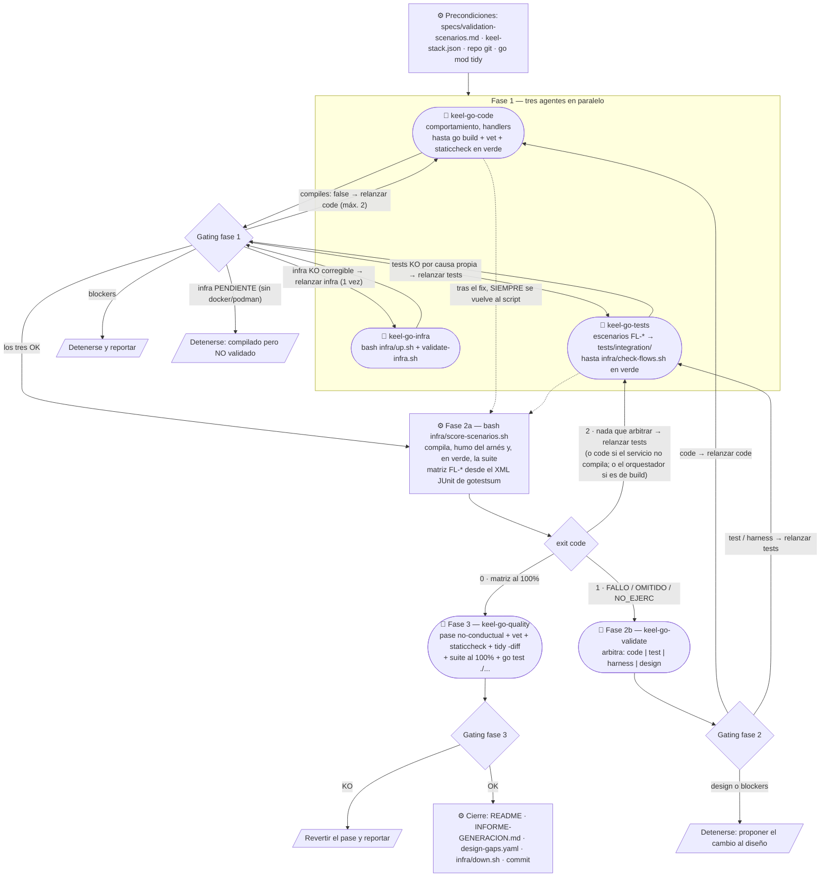

# Orquestación de agentes — cómo se completa el proyecto

Cómo la skill `/keel-generate-go` —ejecutada **dentro de este proyecto**, sin argumentos— lo completa hasta
dejarlo funcional y validado. La skill **no escribe código**: es la **orquestadora** de cinco subagentes, y decide
el avance y los relanzamientos (gating) sobre el bloque estructurado (`status`, `blockers`, `failures`…) con el que
cada uno cierra su reporte.

Es el **mismo pipeline** que el de keel-spring, keel-nest y keel-dotnet, con las mismas fases, los mismos códigos
de salida y la misma regla de quién arbitra: el objetivo de keel-go es que el mismo diseño produzca un servidor
equivalente, y para eso también tiene que validarse igual. Lo que cambian son los comandos.

Lo **determinista** —compilar, ejecutar la suite y derivar la matriz de escenarios del XML JUnit— lo hace el
orquestador con `infra/score-scenarios.sh`; el agente de arbitraje solo se invoca cuando esa matriz trae algo en
rojo. Una generación que sale limpia no gasta una sesión en decir «todo OK».

## Punto de partida: qué dejó hecho `build`

`keel-go build` ya generó de forma **determinista** todo lo transversal: el módulo compila con `go vet` y
staticcheck limpios y arranca, con el dominio (value objects con sus guardas, entidades con su estado, sus
accesores y la guarda del lifecycle, errores como centinelas), los puertos, por operación su mensaje y su handler
con `TODO`, `UseCases` con la transacción y el log de frontera de cada caso de uso, la API REST entera (rutas,
lectura y validación de cada petición, `ErrorResponse`), la persistencia (el esquema como migración de goose, los
adaptadores, el bloqueo optimista, la traducción de constraints), la configuración por perfiles, la
infraestructura de prueba en `infra/` y el arnés de integración. Lo que queda para los agentes es el
**comportamiento de las entidades** (constructor, métodos de negocio, invariantes), la **lógica de los
handlers**, las pruebas de los escenarios y la validación contra el servidor real.

Lo que escribe el agente está siempre en un archivo **sin** la cabecera `// Code generated by keel-go. DO NOT
EDIT.`: un `<entidad>_behavior.go` junto a cada entidad, un `<operación>_{command,query}_handler.go` por operación
y, si build no supo derivar un mapeo entero, ese `<entidad>_mapper.go`. Lo demás lo reescribe el siguiente build.

> **Sin pruebas unitarias nuevas; con pruebas de integración.** Los escenarios `FL-*` de `validation-scenarios.md`
> se traducen **una vez** a pruebas de flujo (`tests/integration/`, tras la restricción `integration`, caja negra
> contra el contrato) y se ejecutan contra la infraestructura real. El criterio de «generación terminada» es el
> módulo en verde con `go vet` y staticcheck + el **100%** de los escenarios en OK. Las pruebas que `build` dejó
> junto al código (arranque bajo el perfil `test`, configuración, contrato del cable, API, cableado, idempotencia,
> frontera) se conservan y se ejecutan en la fase 3 con `go test ./...`: no se escriben otras.

## El pipeline

## Por qué la fase 1 son tres agentes y ninguno espera a otro

Todos sus insumos están en disco antes de empezar (`specs/`, `keel-stack.json`, `infra/`, el arnés), así que no hay
arista entre ellos:

- **`tests` no espera a `infra`**: escribir las pruebas no toca un contenedor; su gate es compilar.
- **`tests` no espera a `code`, y no puede quedar preso de él**: las pruebas de flujo no importan ningún paquete
  del servicio (lo comprueba `infra/check-flows.sh`), así que compilan solas y un `internal/` a medio escribir no
  las pone en rojo.
- **`code` no ve el trabajo a medias de `tests`**: `go build ./...` y `go vet ./...` no compilan
  `tests/integration/`, que va tras la restricción `integration`.
- **El paralelismo es la garantía de independencia**: el autor de las pruebas nunca ve el código terminado (no lee
  `internal/`), así que el test no puede acomodarse a lo que el código hace.

## Por qué la fase 2 está partida en dos

Ejecutar la suite y derivar «FL-x → OK | FALLO» del XML **no requiere criterio**: es parsear, y lo hace el script
con los mismos programas con los que los otros tres generadores puntúan su XML. Decidir de quién es la culpa de un
fallo sí lo requiere, y no puede hacerlo quien tiene que poner la suite en verde: si fuera `keel-go-code`,
`culprit: test` sería su salida barata y el `Then` acabaría ajustándose al código.

El script lo invoca el orquestador y por eso su salida es compacta: la de `go test` va entera a
`build/keel-scenarios/run.log`, la del servidor a `build/keel-scenarios/server.log`, y por stdout solo sale la
matriz. El orquestador es la sesión más larga del pipeline; no vuelques esos logs en su contexto salvo para
diagnosticar.

## Los códigos de `score-scenarios.sh`

| Código | Significa | Qué se hace |
|---|---|---|
| `0` | matriz al 100% | fase 3, sin invocar al árbitro |
| `1` | hay `FL-*` en FALLO, OMITIDO o NO_EJERC | fase 2b: `keel-go-validate` con la matriz y los volcados |
| `2` | **nada que arbitrar**: el servicio o las pruebas no compilan, el humo del arnés está rojo, la matriz está vacía, la suite falló por pruebas que no son escenarios, un flujo no llegó a arrancar sin dejar ningún FALLO, o `specs/` no casa con su sello | según la causa (ver abajo); no consume cupo |

(El código `3` de keel-spring —workers de Gradle que sostienen `build/`— no existe aquí.)

### Un exit 2 no siempre es del agente de pruebas

- **`BUILD: KO`** (no compila): los errores que imprime dicen de quién. En `internal/` o `cmd/`, de
  `keel-go-code`; en `tests/integration/`, de `keel-go-tests`.
- **El humo, o un flujo, dentro de `tests/integration/`**: del agente de pruebas, salvo que el defecto esté en un
  archivo del arnés (los que llevan la cabecera de código generado): eso es `harness`.
- **Fuera**: `infra/`, `go.mod`. Eso lo escribe `keel-go build`; lo corrige el orquestador y va a
  `INFORME-GENERACION.md` como fix del **generador** a portar.

### Un flujo que no arranca sale OMITIDO

Si el arranque de un flujo falla (el servidor no arranca, el reset falla, o su `given`), `StartFlow` da sus
escenarios por **OMITIDOS**, no por fallidos, y vuelca `build/keel-failures/<TestFlujo>-init.json` con la causa y
el último sondeo; el script lo lista como arnés roto. Si la causa es el **comportamiento del servidor** (no arranca
porque el código está mal), es `culprit: code` como cualquier otro rojo.

### Un `NO_EJERC` es rojo, y tiene dueño

Un escenario declarado en `validation-scenarios.md` que ninguna prueba ejercita sale `NO_EJERC` y el script sale
con `1`. Si se puede escribir, es cobertura que falta (`keel-go-tests`, sin cupo); si no se puede por la superficie
que el propio escenario exige, es `culprit: design` y **se detiene**. Y detenerse significa no tocar el diseño, ni
aquí ni en el workspace: un `culprit: design` se **propone** en `design-gaps.yaml` y en el informe.
`score-scenarios.sh` comprueba el sello de `specs/` y sale con `2` si alguien lo editó.

## Los cinco agentes

| Agente | Responsabilidad | Qué NO hace |
|---|---|---|
| `keel-go-code` | El comportamiento de cada entidad (`_behavior.go`), la lógica de cada handler, las guardas del formato, hasta `go build`, `go vet`, staticcheck, gofmt y la frontera en verde, y el gate del formato. Antes de cada handler, la auditoría de `conventions/flow-fidelity.md`. Relanzado desde la fase 2, lee la evidencia cruda y verifica su fix con el flujo afectado. | No escribe pruebas, no toca `tests/`, no levanta contenedores, no añade módulos ni edita archivos con la cabecera de código generado. Su verde por flujo no aprueba escenarios. |
| `keel-go-infra` | Levanta `infra/` (`bash infra/up.sh`) y la sondea (`bash infra/validate-infra.sh`); la deja arriba. | No edita código ni scripts de `infra/`. |
| `keel-go-tests` | Traduce **una vez** los escenarios a `tests/integration/<flujo>_test.go`, en caja negra, hasta `bash infra/check-flows.sh` en verde. | **No lee `internal/` ni `cmd/`**, no implementa negocio, no ejecuta las pruebas en la fase 1. |
| `keel-go-validate` | **Árbitro**: decide, contra el `Then` original y los volcados de `build/keel-failures/`, si cada fallo es `code`, `test`, `harness` o `design`. Solo corre si hay rojo. | No ejecuta la suite ni compone la matriz; no corrige código ni pruebas. |
| `keel-go-quality` | Pase **no-conductual** sobre lo que escribió el agente, con las herramientas de la red del generador (`go vet`, staticcheck, gofmt, `go mod tidy -diff`, govulncheck), la no-regresión (la suite al 100%) y `go test ./...`. | Nada conductual: se reporta en `remaining`. |

Regla común: ningún agente pregunta al usuario —registra sus bloqueos en `blockers` y termina— y ningún hueco del
diseño se resuelve en silencio en el código: se propone en `designGaps`.

**La orquestación es de un solo nivel.** Los cinco son **hojas**: el único que invoca agentes es la skill. El cupo
de ciclos se cuenta sobre las invocaciones del orquestador, el gating se decide sobre el bloque del agente
invocado, y las restricciones que hacen válida la validación —el de pruebas sin leer `internal/`, el árbitro sin
corregir, el de calidad sin cambiar comportamiento— son **del agente**: un subagente lanzado por él no las
heredaría.

## Handoffs

| Campo | Lo emite | Lo consume | Para qué |
|---|---|---|---|
| `compiles` / `lint` / `failures` | code | orquestador | relanzar code con sus errores (máx. 2 ciclos en fase 1) |
| `status: PENDIENTE`, `runtime` | infra | orquestador | detenerse sin docker/podman; el runtime del `down` final |
| `files` / `uncovered` / `assumptions` | tests | orquestador, validate | qué flujos se tradujeron, qué no y por qué, y qué se dio por cierto de la infraestructura |
| matriz + `exit code` | ⚙ `score-scenarios.sh` | orquestador | `0` → fase 3 · `1` → árbitro · `2` → según la causa |
| `failures[].culprit` + `evidence` + `file` | validate | orquestador, code/tests relanzados | a quién relanzar y con qué evidencia exacta |
| `blocking: systemic \| scoped` | validate | orquestador | cómo se cuenta el ciclo |
| `harnessPatches` | tests (relanzado) | orquestador, informe | parches al arnés: son defectos del generador |
| `verifiedFlows` | code (relanzado) | orquestador | qué flujos verificó; NO aprueba escenarios |
| `scenarios` / `unitTests` / `modules` | quality | orquestador | no-regresión, `go test ./...` y el módulo intacto |
| `remaining` / `designGaps` / `blockers` | cualquiera | usuario, informe | lo que queda pendiente de decisión |

## El ciclo de fix se verifica a sí mismo, pero no se aprueba a sí mismo

El agente relanzado en la fase 2 cierra ejecutando **los flujos que le señaló el arbitraje**
(`go test -tags integration -count=1 -run '^Test<Flujo>$' ./tests/integration/`). Ese verde no aprueba nada: un fix
puede regresionar otro flujo, y la matriz sale del XML de **una** ejecución completa. Tras cualquier ciclo de fix se
vuelve **siempre** a `bash infra/score-scenarios.sh`.

Si una tanda mezcla `culprit: code` con `culprit: test`/`harness`, se relanzan **en serie** (primero code): los dos
ejecutan flujos sobre la misma base, y el reset de uno borra los datos del otro.

## Un solo actor sobre el proyecto

Mientras un agente está vivo, nadie más toca este directorio —el orquestador incluido—: el script sobrescribe
`build/keel-failures/` (la evidencia que el árbitro está leyendo), el reset vacía la base que otro está usando, y en
Windows un servidor de flujos vivo retiene su binario (`build/keel-scenarios/`), así que otra ejecución de los
flujos a la vez no lo puede recompilar. Y el trabajo de un agente no lo hace el orquestador aunque sepa hacerlo: las
restricciones que lo hacen válido son del agente. La única ventana del orquestador es la fase 2a y el cierre.

## Ciclos de fix

El cupo de la fase 2 son los ciclos código → re-puntuación por fallos puntuales (`blocking: scoped`), y escala con
el número de flujos `FL-*`:

| Flujos `FL-*` | Ciclos `scoped` | Tope duro |
|---|---|---|
| hasta 10 | 2 | 4 |
| 11–20 | 3 | 5 |
| más de 20 | 4 | 6 |

No consumen cupo los ciclos que cierran un bloqueo sistémico (`blocking: systemic`: una causa transversal que
impedía ejercitar casi cualquier escenario), ni los `culprit: test` o `harness`, que no dicen nada del código.
Alcanzado el tope, se reporta la matriz y se detiene.

## El cierre devuelve al generador lo que es del generador

El cierre escribe `INFORME-GENERACION.md` en la raíz, que abre con **la matriz final y su código de salida,
literales** —si no está al 100%, el proyecto no está cerrado—, y sigue con: (1) incidencias del generador
(`harnessPatches`, fixes de `infra/` o de `go.mod`, los `failures` con `culprit: harness`), cada una diciendo **de
quién es**; (2) código determinista mejorable; (3) agentes y convenciones donde un ciclo fue largo por falta de un
antecedente; (4) huecos del diseño.

Y los huecos del diseño se escriben además en `design-gaps.yaml` (schema `design-gaps.schema.json` de keel-core,
sellado con el `service` y la `version` de `specs/service.keel.yaml`), una entrada por hueco con `layer`, `unit`,
`kind`, `proposal`, `source` y el `scenario` que lo destapó. `keel-go check` los imprime desde el workspace y
`/keel-evolve` los recoge. **Copia ese archivo fuera del proyecto antes de tirarlo**: comparar huecos entre corridas
es lo que distingue el hueco de un diseño del hueco del método.

Un hueco que `specs/gaps.yaml` ya trae con `state: accepted` (o que `specs/decisions.yaml` acepta)
**no se reporta**: es una decisión tomada por escrito, con su motivo y el disparador que la reabriría. Si crees que
ese disparador ya se cumplió, dilo en el informe, no en `design-gaps.yaml`. Reportarlo como nuevo lo cuenta como
hueco del diseño en el registro de corridas, y no lo es.

## Modo evolución: el proyecto ya existía

Un proyecto completado no se regenera desde cero cuando cambia su diseño. El diseñador ejecuta
`keel-go build specs/<servicio> --refresh --prune` en el workspace, y build deja en
`build/keel-refresh/EVOLUTION.md` lo que cambió desde la última vez que se completó. El documento y su lógica son los
de los otros tres generadores (`keel-core/gen/evolution.js`): solo cambian las rutas de esta plataforma.

> **Estado de keel-go:** esta versión todavía no escribe `EVOLUTION.md` (llega con su incremento de evolución).
> `--refresh` ya pone al día lo que generó build sin pisar lo del agente, pero el delta del diseño hay que leerlo a
> mano. Sin `build/keel-refresh/EVOLUTION.md`, el pipeline es el de una primera generación.

| Sección | Qué es | Para quién |
|---|---|---|
| 1. Fusiones pendientes | Archivos que el agente completó y el generador volvió a cambiar; la versión nueva está en `build/keel-refresh/<ruta>` | `keel-go-code` |
| 2. Huérfanos a retirar | Lo que build ya no emite y alguien tocó (lo intacto ya lo borró `--prune`) | `keel-go-code` |
| 3. Cambios del diseño | Delta por capa y sección: añadido, quitado, cambiado | `keel-go-code` |
| 4. Escenarios | `FL-*` añadidos, cambiados y quitados, y sus familias | `keel-go-tests`, y solo esto |
| 5. Archivos nuevos con TODO | Los stubs nuevos | `keel-go-code` |
| 6. Stack | Categorías que el diseño empezó o dejó de pedir | `keel-go-infra` y `keel-go-code` |

El pipeline es el mismo; lo que cambia es el alcance de la fase 1. La fase 2a no se acota nunca: `score-scenarios.sh`
corre la suite **completa**, y las pruebas de los flujos que no se tocaron son la no-regresión de lo que ya
funcionaba.

La versión nueva de un conflicto cae en `build/keel-refresh/` y no junto al archivo: dentro de `internal/` la
compilaría `go build` (un paquete son todos sus `.go`) y declararía dos veces lo mismo.

**Cierre, y es del orquestador**:
1. Quitar de `pendingMerge` (en `keel-generated.json`) las rutas fusionadas: mientras quede una entrada,
   `keel-go build --check` sale en rojo.
2. Borrar `build/keel-refresh/`.
3. Hacer el commit.

Hasta entonces nadie borra `build/`.

## Autosuficiencia del proyecto

`build` deja aquí todo lo que el pipeline necesita: la skill orquestadora, los cinco agentes, las convenciones
(`{{keel:docs}}/conventions/`), `architecture.md`, `constitution.md`, la skill de la base de datos y el snapshot del
diseño en `specs/`. El canónico del diseño sigue siendo `specs/<servicio>/` del workspace: un cambio funcional se
hace allí, se re-ejecuta `keel-go build specs/<servicio> --refresh --prune` y se vuelve a entrar aquí, en modo
evolución (ver [Modo evolución](#modo-evolución-el-proyecto-ya-existía)).
